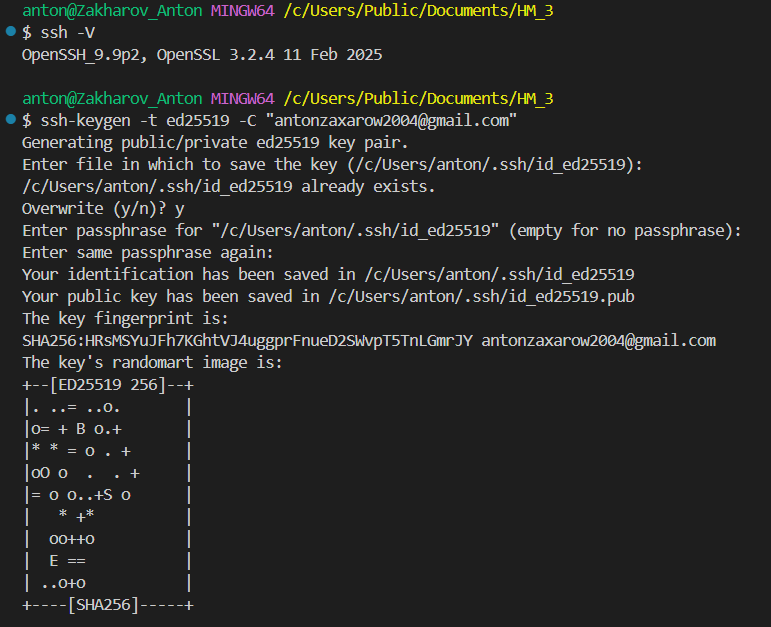
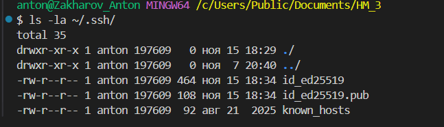
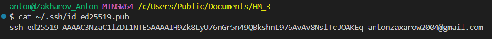
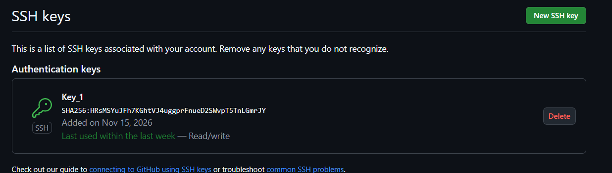
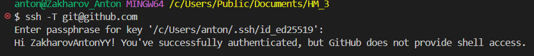

# Настройка SSH-доступа к GitHub

## 1. Установка SSH-клиента и генерация ключевой пары

### Проверка версии SSH
```bash
ssh -V
```

### Генерация ключа
```bash
ssh-keygen -t ed25519 -C "antonzaxarow2004@gmail.com"
```

### Проверка файлов
```bash
ls -la ~/.ssh/
```

### Публичный ключ
```bash
cat ~/.ssh/id_ed25519.pub
```

### Вывод





## 2. Добавление публичного ключа в GitHub

### Вывод


## 3. Проверка SSH-подключения

```bash
ssh -T git@github.com
```

### Вывод

